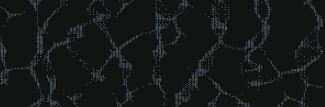

The header of this site is sunlight shining through a rippling pool, drawn on the pool floor in braille dots or ascii characters.

- **Surface:** wind waves from a Phillips spectrum, plus ripples you make with the pointer (a small wave automaton).
- **Light:** rays bend at the surface by Snell's law and land on the floor; where they bunch up, the floor is bright.
- **Characters:** each braille dot or character shows how much light landed under it.

The sun is computed live for San Antonio, and the color of the water follows it.